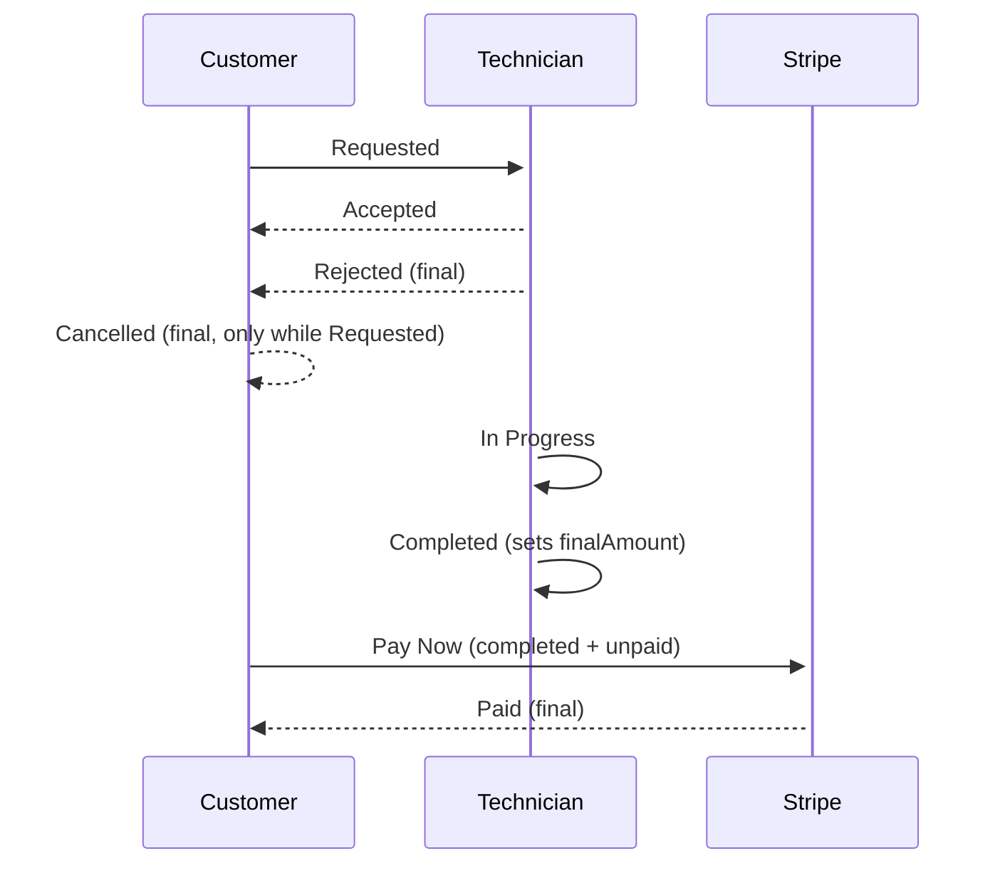

<div align="center">

# FixMate API

[](https://fixmate-server-qkj7.onrender.com)
[](https://github.com/SamaunRezvi/assignment_nine_c)
[](#overview)
[](#api-reference)
[](#get-started-locally)

## Book the job. Pay after it's done.

Backend API for FixMate, an on-demand device and home appliance repair service booking platform.

**ROLE-BASED JWT AUTH** · **SERVER-ENFORCED STATUS PIPELINE** · **STRIPE PAY-AFTER-SERVICE** · **SEARCH, FILTER, SORT**

</div>

## Overview [](#overview)

FixMate connects customers with verified technicians for device and appliance repairs. Technicians list their services, customers send repair requests, jobs move through a tracked status pipeline, and payment happens only after the job is marked completed.

| | |
|---|---|
| Live API | https://fixmate-server-qkj7.onrender.com |
| Client repository | https://github.com/SamaunRezvi/assignment_nine_c |
| Client live site | https://fixmate-nu-five.vercel.app |

## Test Credentials

All seeded accounts use the password `Password123`.

| Role | Email |
|---|---|
| Admin | admin@fixmate.test |
| Technician | rafiq.technician@fixmate.test |
| Technician | nadia.technician@fixmate.test |
| Technician | imran.technician@fixmate.test |
| Customer | tanvir.customer@fixmate.test |
| Customer | sumaiya.customer@fixmate.test |

## Tech Stack

[](https://skillicons.dev)

| Layer | Technology | Responsibility |
|---|---|---|
| Runtime | Node.js, Express, TypeScript | HTTP server and routing |
| Database | MongoDB (native driver) | 4 collections: users, services, bookings, payments |
| Authentication | BetterAuth, MongoDB adapter | Email/password and Google sign-in |
| Authorization | JWT, custom middleware | verifyToken, verifyCustomer, verifyTechnician, verifyAdmin |
| Payments | Stripe Checkout, webhook | Pay-after-service, deduplicated by stripeSessionId |

## Key Features

- Role-based middleware (`verifyToken`, `verifyCustomer`, `verifyTechnician`, `verifyAdmin`) protecting every private route
- Server-side search, filter (category, service mode, area), sort, and pagination for the services listing
- Strict server-enforced job status pipeline (requested → accepted/rejected/cancelled → in-progress → completed → paid), no stage can be skipped or reversed
- Stripe Checkout session creation, success-page verification, and webhook handling with payment deduplication
- Google social sign-in alongside email and password, via BetterAuth
- Rating and review on paid bookings, with average rating surfaced on service listings
- Derived "verified technician" status for any technician with at least one admin-approved service
- Public technician profile endpoint listing a technician's approved services
- Admin endpoints for user role management, service approval, and platform-wide monitoring

## Booking Status Pipeline



## API Reference [](#api-reference)

| Endpoint | Middleware | Notes |
|---|---|---|
| `GET /api/services` | Public | Search, filter, sort, pagination |
| `GET /api/services/:id` | Public | 404 unless approved and available |
| `GET /api/services/featured` | Public | Latest 6 approved services |
| `POST /api/services` | verifyToken, verifyTechnician | Creates with approvalStatus: pending |
| `PATCH /api/services/:id` | verifyToken, verifyTechnician | Owner only, resets to pending |
| `DELETE /api/services/:id` | verifyToken, verifyTechnician | Owner only |
| `GET /api/technicians/:email` | Public | Profile and approved services |
| `POST /api/bookings` | verifyToken, verifyCustomer | Rejects duplicate active requests |
| `GET /api/bookings/my` | verifyToken, verifyCustomer | Own bookings only |
| `GET /api/bookings/technician` | verifyToken, verifyTechnician | Own jobs only |
| `PATCH /api/bookings/:id/status` | verifyToken, verifyTechnician | Enforced pipeline, owner only |
| `PATCH /api/bookings/:id/cancel` | verifyToken, verifyCustomer | Only while requested |
| `PATCH /api/bookings/:id/rating` | verifyToken, verifyCustomer | Only on a paid, completed, unrated booking |
| `POST /api/payments/create-checkout-session` | verifyToken, verifyCustomer | Amount always server-derived |
| `GET /api/payments/verify` | verifyToken, verifyCustomer | Success-page verification |
| `POST /api/payments/webhook` | Stripe signature | Deduplicated by stripeSessionId |
| `GET /api/admin/*` | verifyToken, verifyAdmin | Users, services, bookings, payments |
| `PATCH /api/users/profile` | verifyToken | Own profile only |

## Get Started Locally [](#get-started-locally)

```bash
git clone https://github.com/SamaunRezvi/assignment_nine_s.git
cd assignment_nine_s
npm install
cp .env.example .env
npm run dev
```

### Environment Variables

| Variable | Description |
|---|---|
| `MONGODB_URI` | MongoDB Atlas connection string |
| `DB_NAME` | Database name |
| `JWT_SECRET` | Secret for signing API JWTs |
| `BETTER_AUTH_SECRET` | BetterAuth session secret |
| `BETTER_AUTH_URL` | This server's own base URL |
| `CLIENT_URL` | Client origin, used for CORS and BetterAuth trusted origins |
| `STRIPE_SECRET_KEY` | Stripe test mode secret key |
| `STRIPE_WEBHOOK_SECRET` | Stripe webhook signing secret |
| `IMGBB_API_KEY` | ImgBB API key for image uploads |
| `GOOGLE_CLIENT_ID` | Google OAuth client id |
| `GOOGLE_CLIENT_SECRET` | Google OAuth client secret |

## Live booking notifications

Authenticated endpoints:

- `GET /api/notifications`: latest 30 booking-history events, unread count, and preferences.
- `GET /api/notifications/stream`: Server-Sent Events, using the existing Bearer JWT header.
- `PATCH /api/notifications/preferences`: `{ "enabled": true }` saves the user's alert preference.
- `PATCH /api/notifications/read`: `{ "readAt": "<ISO timestamp>" }` advances the user's read watermark.

Customer events are restricted to their own bookings; technicians receive events
for their assigned bookings; admins receive platform booking events. The API
reads persisted booking history every three seconds while connected, so it works
across API instances and recovers missed events on reconnect. Streams rotate
after 55 seconds for reauthentication, stop querying on disconnect, and avoid
proxy buffering. No MongoDB change streams or additional services are required.

Preferences and read state are stored on the user record. Existing users default
to alerts enabled. Deploy this server before the corresponding client update.

Run `npm run test:notifications` for role scoping, authentication, preference/read
validation, SSE delivery, reconnect recovery, and disconnect cleanup tests using
an isolated in-memory database stub.

Review submissions atomically save the rating, feedback, `ratedAt`, and a `rated`
history event only once. The notification stream includes a feedback alert for
the booking participants and admins. Run `npm run test:reviews` to verify owner
and payment restrictions, review validation, duplicate protection, and event creation.

Admin Transactions reads the `payments` collection, newest payment first, and
reports the sum of stored payment amounts as total revenue. Seed/demo records
are included when present; this total is recorded gross payments, not platform
commission or technician payouts. Payment descriptions use the booked service
title, while device-specific problems remain in the booking description.

## npm Packages Used

express, mongodb, cors, dotenv, jsonwebtoken, stripe, better-auth, typescript, ts-node-dev

<div align="center">

**FIXMATE API**

Role-based repair booking backend, built with Express and MongoDB

[Explore FixMate ↗](https://fixmate-nu-five.vercel.app) · [Back to top ↑](#fixmate-api)

</div>
